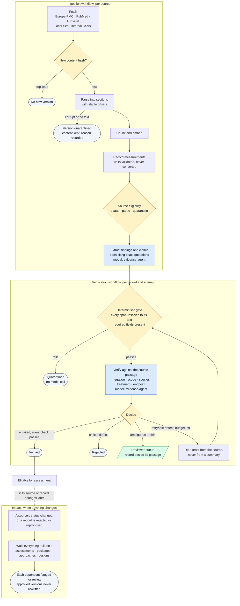

# ankka-experiment-proposals

An [ankka](https://github.com/thinkmorestupidless/ankka) service: the evidence-driven scientific
experimental design proof of concept for a cultivated-food company. It turns a customer request such as
"Can you make foie gras?" into reviewable requirement facets, scientific questions, reproducible
searches, source-grounded findings and claims verified against the original text, question-specific
evidence assessments with claim-relative sufficiency, at least two candidate experimental approaches,
and a typed experimental design that a named scientific reviewer approves or rejects. It can answer
"insufficient evidence".

- Specification, plan, research, data model, contracts and tasks:
  `specs/001-evidence-experiment-design/`
- How to run and validate it: `specs/001-evidence-experiment-design/quickstart.md`
- The acceptance scenarios, in Gherkin: `features/`, in the vocabulary of `GLOSSARY.md`
- The documentation, with the motivation, the architecture and how to run and deploy it:
  https://thinkmorestupidless.github.io/ankka-experiment-proposals/ (source under `docs/`)
- What it does not do: `docs/reference/limitations.md`

## How it works

A request moves through stages. A model proposes at every stage it is needed, a deterministic rule
checks the proposal before anything is recorded, and a named scientific reviewer decides at three
points (the facets, the choice of approach, the design) and settles any record the checks leave in
doubt. A failed check sends the stage back with its classified defect, within a budget of two
retries; a stage that still fails is recorded and the process pauses for the operator. Every stage
writes what it read, what it produced and which checks ran to the run's provenance record
(`GET /runs/{id}`), so any conclusion can be traced to the source text behind it.

| Colour | Meaning |
|---|---|
| Blue | a model proposes (an ankka agent with a versioned prompt and a typed reply) |
| Amber | a deterministic gate or rule set checks, with no model involved |
| Green | a named reviewer decides; the workflow pauses with no timeout until they do |
| Grey | an outcome that is recorded and kept, including refusals and rejections |

### The investigation, from request to approved design

```mermaid
flowchart TD
  R(["Customer request<br/>kept byte for byte"]) --> F["Extract facets<br/>model: request-agent"]
  F --> FG{"Facet gate<br/>explicit facets cite the request"}
  FG -- "defect, retry ≤ 2" --> F
  FG -- passes --> RT["Round-trip check<br/>a separate prompt rebuilds the request<br/>and lists omissions and additions"]
  RT --> H1[/"Reviewer confirms, amends<br/>or leaves each facet unresolved"/]
  H1 -- "mandatory facets settled" --> Q["Derive scientific questions<br/>model: request-agent"]
  Q --> QG{"Coverage gate<br/>every mandatory facet investigated"}
  QG -- "coverage gap, retry ≤ 2" --> Q
  QG -- passes --> P

  subgraph PQ["For each question, in parallel"]
    P["Plan the search<br/>model: search-agent"] --> PG{"Plan gate<br/>≥ 1 lexical and ≥ 1 semantic query"}
    PG -- passes --> X["Execute: lexical and semantic<br/>over the chunk store, plus external indexes"]
    X --> FU["Fuse ranks with RRF<br/>source snapshot recorded"]
    FU --> EL{"Eligibility, applied after ranking<br/>retracted · superseded · quarantined"}
    EL -- "removed, reason recorded" --> EXC[("Exclusions")]
    EL -- "nothing eligible" --> CG["Coverage gap<br/>not evidence of absence"]
    CG --> SS["Supplemental search<br/>bounded at 2 per gap"] --> X
    EL -- eligible --> CTX["Resolve context<br/>section · neighbours · tables"]
    CTX --> A["Assess each verified record<br/>model: evidence-agent"]
    A --> AR{"Applicability rules<br/>species or endpoint mismatch is never direct"}
    AR --> S["Judge sufficiency for each decision<br/>model: evidence-agent"]
    S --> SR{"Sole affirmative evidence?"}
    SR -- yes --> HQ[/"Reviewer checks the record"/]
  end

  SR -- "no · operator asks to package" --> PK["One evidence package per question"]
  PK --> PKG{"Package rules<br/>spans resolve · contradictions kept<br/>only verified, eligible records · no critical trim"}
  PKG --> C["Propose ≥ 2 candidate approaches<br/>compared on 8 criteria<br/>model: design-agent"]
  C --> CG2{"Gate and guardrail<br/>every assumption labelled<br/>no probability of success"}
  CG2 -- "fewer than two, retry ≤ 2" --> C
  CG2 -- "probability asserted" --> STOP(["Refused and recorded<br/>paused for the operator"])
  CG2 -- passes --> H2[/"Reviewer selects one approach<br/>with reasons for the others"/]
  H2 --> D["Write the twelve-section design<br/>model: design-agent"]
  D --> DG{"Design rules<br/>every claim verified · every span resolves<br/>mandatory facets accounted for"}
  DG -- "unverified claim, retry ≤ 2" --> D
  DG -- passes --> H3[/"Reviewer approves, rejects<br/>or requests changes"/]
  H3 -- "changes requested" --> D
  H3 -- approved --> DONE(["Approved design"])
  H3 -- rejected --> REJ(["Rejection kept with its reason"])

  classDef agent fill:#dbeafe,stroke:#1d4ed8,color:#0f172a
  classDef gate fill:#fef3c7,stroke:#b45309,color:#0f172a
  classDef human fill:#dcfce7,stroke:#15803d,color:#0f172a
  classDef stop fill:#f1f5f9,stroke:#475569,color:#0f172a
  class F,Q,P,A,S,C,D agent
  class FG,QG,PG,EL,AR,SR,PKG,CG2,DG gate
  class H1,HQ,H2,H3 human
  class R,STOP,DONE,REJ,EXC stop
```



Two things the diagram implies are worth saying plainly. Retrieval decides relevance and eligibility
decides admissibility, separately: a retracted paper can rank first and is still removed, with the
rule that removed it recorded on the search. And an empty or ineligible result is a coverage gap
caused by the search, never evidence that the answer is "no"; the system can conclude "insufficient
evidence" and does.

### How one piece of evidence earns its place

Findings and claims are extracted when a source is ingested, before any question asks for them, and
each must survive two independent checks before an assessment may use it.



## How it is built

Every record (request, facet, question, source, finding, claim, assessment, sufficiency, package,
candidate approach, decision, design, stage run) is an event sourced entity, so its history is kept
and nothing is edited in place. The two processes, ingestion and investigation, are workflows whose
steps are journalled, so a failure resumes rather than restarts and a reviewer's decision is a pause
with no timeout. Every model-dependent stage is an agent handler returning a structured reply that a
deterministic gate and a separate source-context verification must pass before it counts. Listings
and retrieval are views; impact propagation is a consumer that starts a workflow.

The component table in `specs/001-evidence-experiment-design/plan.md` is the design the code is held to.

Needs: JDK 21, sbt, Docker, the `ankka` CLI, `uvx` (for the bdd checker), `just` (optional).

## Test

```bash
just test-unit          # no Docker
just test-integration   # a throwaway Postgres in Docker
just features-replay    # the living features through HTTP, against recorded model replies
just faults             # the six reference faults, each caught at its gate
just independent        # the suite written from the spec alone
just mutants            # three safeguards disabled in disposable copies; each must fail a test
just eval               # the labelled evaluation; writes evals/reports/
just check-bdd          # the features, the glossary and the spec
just pr                 # all of the above and the independent suite
```

The live tier (`just features-live`, `EDP_TIER=live just eval`) needs `ANTHROPIC_API_KEY`.

## Run locally

```bash
cp .env.example .env && cp evals/reviewers.example.json reviewers.json
just up                 # sbt schema, then Postgres from target/ddl
just run                # http://localhost:9000; GET /healthz needs no token
ankka local console     # http://localhost:9889: components, routes, traces
```

Postgres applies its init directory only to an empty volume: after `sbt schema` changes anything,
`just down` first.

## Deploy to an ankka platform

`service.json` is the descriptor `ankka services apply` takes. It names the image, the ankka version,
and the `EDP_*` variables; the token and the model key come from a Kubernetes Secret named
`edp-config` with keys `api-token` and `anthropic-api-key`, which you create in the project's namespace.

```bash
sbt Docker/publishLocal
kind load docker-image ankka-experiment-proposals:latest --name ankka   # a local kind cluster
ankka services apply -f service.json
ankka services expose ankka-experiment-proposals
```

`/api/v1` and `/review` admit only the shared token; `/healthz` is open and read-only.

## Work with a coding agent

This project carries ankka's documentation for the version it was made with, as Agent Skills in
`.claude/skills/`, the spec-kit skills (`speckit-*`) with the bdd extension, and a `.mcp.json` that
starts `ankka mcp`.

## Upgrading ankka

The ankka version lives in two places that must move together: `ankkaVersion` in `build.sbt` and
`runtime` in `service.json`. Then `sbt schema` and `just down && just up` for the local database.
